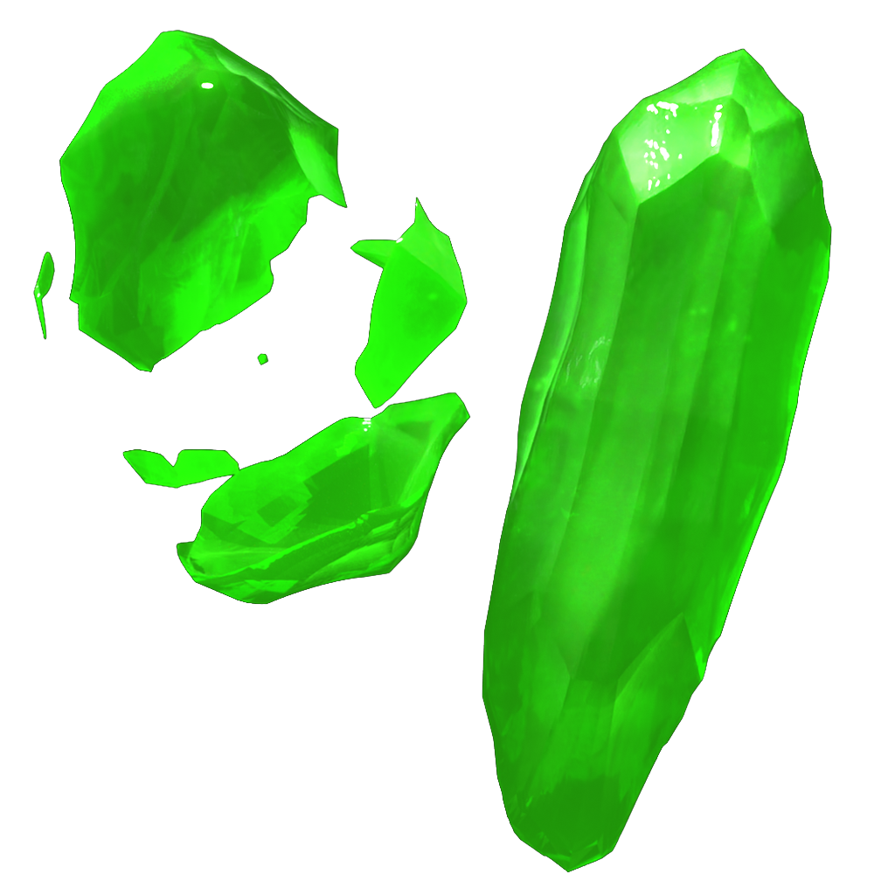

[![Buy Me A Coffee](https://shields.io/badge/Support%20Me-Buy%20Me%20A%20Coffee-yellow?style=flat&logo=)](https://www.buymeacoffee.com/cptwesley)
  
| Package           | Stable | Preview | Downloads |
|-------------------|--------|---------|-----------|
| Warpstone         | [](https://www.nuget.org/packages/Warpstone/) | [](https://www.nuget.org/packages/Warpstone/absoluteLatest) | [](https://www.nuget.org/packages/Warpstone) |
| Warpstone.Sources | [](https://www.nuget.org/packages/Warpstone.Sources/) | [](https://www.nuget.org/packages/Warpstone.Sources/absoluteLatest) | [](https://www.nuget.org/packages/Warpstone.Sources) |
  


# Warpstone
Parser combinator forged deep within Ikit's forges in the Under-City from a shard of Morrslieb itself.

## What is it?
Warpstone is a parser combinator library written in C# targetting .NET Standard 2.0, meaning that it can be used by any application running either .NET Framework >= 4.6.1, .NET Core >= 2.0 or Mono >= 5.4.
The main focus of the library is to provide a powerful lightweight parser combinator framework for developers to create their own parsers with.

## Why did you make it?
After following a course on compiler construction I was intrigued and wanted a way of parsing languages within code without requiring external tools to generate a parser for me first.
During my quest I stumbled upon the concept of parser combinators and started looking for existing libraries for .NET.
I soon stumbled upon [Pidgin](https://github.com/benjamin-hodgson/Pidgin).
After toying around with the library for a bit I felt dissatisfied with some of its syntax and I still felt like I didn't fully understand the concepts it was using behind the scenes.
This led me to create my own parser combinator library, with syntax inspired by Pidgin.

## Why the name? (Or: What are all those strange words in the description?!?!?)
Coming up with names is difficult, I wanted to get the project started and at the time I was consumed by the Warhammer Fantasy universe.

## Where do the ideas come from?
Warpstone's implementation draws on the following work:
- [Packrat Parsing: Simple, Powerful, Lazy, Linear Time](https://arxiv.org/abs/cs/0603077) (Bryan Ford, ICFP 2002): the original packrat paper. It shows how memoizing every rule result makes a backtracking recursive-descent parser run in linear time.
- [Packrat Parsers Can Support Left Recursion](https://web.cs.ucla.edu/~todd/research/pepm08.pdf) (Alessandro Warth, James R. Douglass and Todd Millstein, PEPM 2008): the "seed growing" technique for left-recursive rules that Warpstone's `Grow` parser is based on.
- [Left-recursive PEG Grammars](https://medium.com/@gvanrossum_83706/left-recursive-peg-grammars-65dab3c580e1) (Guido van Rossum, 2019): part of the blog series behind Python's [pegen](https://github.com/gvanrossum/pegen) parser generator. Warpstone uses its approach of picking one "leader" rule per left-recursive cycle and growing only that rule. The leader selection itself is pegen's [`compute_left_recursives`](https://github.com/gvanrossum/pegen/blob/bc78cbc9d048ce389cf4d693b875726f56473a8b/pegen/parser_generator.py#L173-L200).
- [Packrat Parsers Can Support Multiple Left-recursive Calls at the Same Position](https://doi.org/10.2197/ipsjjip.29.174) (Masaki Umeda and Atusi Maeda, Journal of Information Processing 29, 2021): handles several left-recursive calls at the same input position. Warpstone falls back to it for cycles that have no single leader.

## How does it compare?
✅ supported, 🟡 partially supported, ❌ not supported.

| Feature                                        | Warpstone V1 | Warpstone V2 | Warpstone V3 | [Pidgin](https://github.com/benjamin-hodgson/Pidgin) | [Parlot](https://github.com/sebastienros/parlot) | [ParsecSharp](https://github.com/acple/ParsecSharp) | [Farkle](https://github.com/teo-tsirpanis/Farkle) |
|------------------------------------------------|:------------:|:------------:|:------------:|:------:|:------:|:-----------:|:------:|
| Left recursion                                 | ❌ | ❌ | ✅ | ❌ | ❌ | ❌ | ✅ |
| Packrat memoization                            | ❌ | ✅ | ✅ | ❌ | ❌ | ❌ | ❌<sup>1</sup> |
| Backtracking choice (no `Try` needed)          | ✅ | ✅ | ✅ | 🟡<sup>2</sup> | ✅ | ✅ | ❌<sup>1</sup> |
| Lookahead (positive/negative)                  | ✅ | ✅ | ✅ | ✅ | ✅ | ✅ | ❌<sup>1</sup> |
| Deeply nested input                            | ❌ | ✅ | ✅ | ❌ | ❌ | ✅ | ✅ |
| Cancellation                                   | ❌ | ✅ | ✅ | ❌ | ✅ | ❌ | ❌ |
| Step-wise execution                            | ❌ | ✅ | ✅ | ❌ | ❌ | ❌ | ❌ |
| Regex parsers                                  | ✅ | ✅ | ✅ | ❌ | ❌ | ❌ | ✅ |
| Operator precedence helpers                    | ✅ | ❌ | ❌<sup>3</sup> | ✅ | ✅ | 🟡<sup>4</sup> | ✅ |
| Monadic bind (context-sensitive parsing)       | ❌ | ✅ | 🟡<sup>5</sup> | ✅ | 🟡<sup>6</sup> | ✅ | ❌ |
| Non-`char` token input                         | ❌ | ❌ | ❌ | ✅ | ❌ | ✅ | 🟡<sup>7</sup> |
| Streaming input (`TextReader`/`Stream`)        | ❌ | ❌ | ✅ | ✅ | ✅ | ✅ | ✅ |
| Compiled / source-generated parsers            | ❌ | ❌ | ❌ | ❌ | ✅ | ❌ | ✅ |
| Source-only package (no assembly dependency)   | ❌ | ❌ | ✅ | ❌ | ❌ | ❌ | ❌ |

1. Farkle is an LALR(1) parser generator, not a PEG/combinator library. It needs no memoization or backtracking and reports grammar conflicts when the grammar is built.
2. A choice only backtracks over consumed input when the branch is wrapped in `Try`.
3. Not needed: write expressions as left-recursive rules.
4. `ChainLeft`/`ChainRight` combinators, no precedence table.
5. Via `Bind`. Left recursion through the selected parser is not grown and fails with an `InfiniteRecursionError`; a selected parser that is not part of the grammar is prepared for parsing each time a new instance is returned.
6. Via `Switch`.
7. Custom tokenizers, input is still text.

Third-party columns reflect each library's documentation and package API at the time of writing (Pidgin 3.5, Parlot 2.3, ParsecSharp 5.2, Farkle 7).

### Performance

Every library parses the same MiniJava subset into the same AST ([`MiniJavaBenchmark`](src/Warpstone.Benchmarks/MiniJavaBenchmark.cs)). Inputs: small (619 chars), medium (7,286 chars) and large (73,241 chars). Lower is better.

Mean CPU time per parse:

| Library                          | Small     | Medium    | Large      |
|----------------------------------|----------:|----------:|-----------:|
| [Parlot](https://github.com/sebastienros/parlot) (source-generated) | 8.1 μs | 92.7 μs | 1.00 ms |
| [Parlot](https://github.com/sebastienros/parlot) (runtime) | 10.4 μs | 124.3 μs | 1.37 ms |
| [Farkle](https://github.com/teo-tsirpanis/Farkle) | 17.1 μs | 208.1 μs | 2.12 ms |
| Warpstone V3                     | 24.7 μs | 297.1 μs | 2.86 ms |
| Warpstone V3 (left-recursive)<sup>7</sup> | 40.6 μs | 524.0 μs | 5.29 ms |
| [Pidgin](https://github.com/benjamin-hodgson/Pidgin) | 101.2 μs | 1.27 ms | 13.52 ms |
| Warpstone V1                     | 487.5 μs | 6.21 ms | 60.29 ms |
| [ParsecSharp](https://github.com/acple/ParsecSharp) | 549.1 μs | 6.84 ms | 67.45 ms |
| Warpstone V2                     | 3.39 ms | 79.51 ms | 805.98 ms |

Memory allocated per parse:

| Library                          | Small     | Medium    | Large      |
|----------------------------------|----------:|----------:|-----------:|
| [Farkle](https://github.com/teo-tsirpanis/Farkle) | 6.5 KB | 65.0 KB | 650 KB |
| [Parlot](https://github.com/sebastienros/parlot) (source-generated) | 6.5 KB | 67.5 KB | 673 KB |
| [Parlot](https://github.com/sebastienros/parlot) (runtime) | 6.6 KB | 67.5 KB | 673 KB |
| Warpstone V3                     | 14.7 KB | 93.9 KB | 866 KB |
| Warpstone V3 (left-recursive)<sup>7</sup> | 22.1 KB | 179.2 KB | 1,696 KB |
| [Pidgin](https://github.com/benjamin-hodgson/Pidgin) | 21.8 KB | 252.0 KB | 2,523 KB |
| Warpstone V1                     | 1,578 KB | 19,116 KB | 191,131 KB |
| [ParsecSharp](https://github.com/acple/ParsecSharp) | 1,956 KB | 24,179 KB | 242,814 KB |
| Warpstone V2                     | 9,069 KB | 109,981 KB | 1,104,776 KB |

7. Binary operators written as left-recursive rules instead of repetitions.

Measured with BenchmarkDotNet 0.16.0-preview.2 (`InProcessEmitToolchain`) on .NET 11.0, AMD Ryzen 9 7950X3D, Windows 11. Reproduce from `src/` with `dotnet run -c Release --project Warpstone.Benchmarks -- --filter "*MiniJavaBenchmark*" --inProcess`.

## Usage
Install the package. V3 is in preview, so include prereleases:

```sh
dotnet add package Warpstone --prerelease
```

Or install `Warpstone.Sources` instead, which compiles the library's source code into your project, so your build output has no `Warpstone.dll` dependency.

### Example: a calculator
The program below parses and evaluates arithmetic such as `(1 + 2) * 3`. It's a complete console app: paste it into `Program.cs` and run it.

```cs
using System;
using Warpstone;
using Warpstone.Errors;
using static Warpstone.Parsers;

// Parse() returns the value and throws if the input is invalid.
Console.WriteLine(Calculator.Expression.Parse("1 + 2 * 3"));   // 7
Console.WriteLine(Calculator.Expression.Parse("(1 + 2) * 3")); // 9
Console.WriteLine(Calculator.Expression.Parse("10 - 4 - 3"));  // 3: '-' groups to the left

// TryParse() doesn't throw. The result holds either a value or the errors.
var result = Calculator.Expression.TryParse("1 + * 2");
if (result.Success)
{
    Console.WriteLine(result.Value);
}
else
{
    foreach (var error in result.Errors)
    {
        Console.WriteLine($"Error at {error.InputStartPosition}");
        if (error is UnexpectedTokenError unexpected)
        {
            Console.WriteLine($"Expected {string.Join(" or ", unexpected.Expected)} but found {unexpected.Found}");
        }
    }
}

public static class Calculator
{
    // A number is one or more digits. Regex() matches the text, Transform() converts it to an int.
    // WithName() sets the name used in error messages instead of the regex pattern.
    private static readonly IParser<int> Number
        = Regex("[0-9]+").Transform(int.Parse).WithName("number");

    // An atom is a number or a sum between parentheses.
    // Sum is declared further down, so Lazy() postpones reading the field until parsing starts.
    // The '!' tells the compiler the field will be set by then.
    // Then() keeps only the right-hand result, ThenSkip() keeps only the left-hand result.
    private static readonly IParser<int> Atom
        = Or(
            Number,
            Char('(').Then(Lazy(() => Sum!)).ThenSkip(Char(')')));

    // A term is atoms joined by '*' or '/'.
    // The rule starts with itself (left recursion). Warpstone detects and supports this, so
    // operators group to the left: 8 / 4 / 2 means (8 / 4) / 2.
    // ThenAdd() keeps both results as a tuple, which Transform() unpacks into two arguments.
    // Or() tries each alternative in order and returns the first that succeeds.
    private static readonly IParser<int> Term
        = Or(
            Lazy(() => Term!).ThenSkip(Operator("*")).ThenAdd(Atom).Transform((left, right) => left * right),
            Lazy(() => Term!).ThenSkip(Operator("/")).ThenAdd(Atom).Transform((left, right) => left / right),
            Atom);

    // A sum is terms joined by '+' or '-'. Because a sum is built from terms,
    // '*' and '/' bind tighter than '+' and '-'.
    private static readonly IParser<int> Sum
        = Or(
            Lazy(() => Sum!).ThenSkip(Operator("+")).ThenAdd(Term).Transform((left, right) => left + right),
            Lazy(() => Sum!).ThenSkip(Operator("-")).ThenAdd(Term).Transform((left, right) => left - right),
            Term);

    // The entry point. ThenEnd() fails if any input is left over, so "1 + 2 abc" is rejected.
    public static readonly IParser<int> Expression
        = Sum.ThenEnd();

    // An operator symbol with optional whitespace on both sides.
    private static IParser<string> Operator(string symbol)
        => OptionalWhitespaces.Then(String(symbol)).ThenSkip(OptionalWhitespaces);
}
```

Output:

```
7
9
3
Error at Index 4 Line 1 Column 5
Expected number or '(' but found '*'
```
